<div align="center">

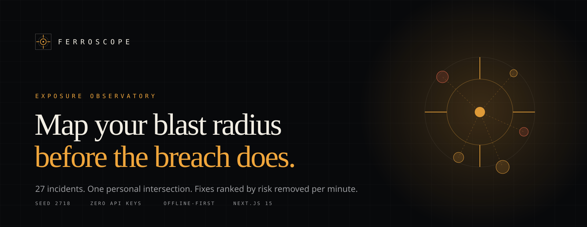

# Ferroscope

**Map your blast radius before the breach does.**

27 incidents landed in 48 hours. Declare the stack you actually run, see which ones intersect it,
then rank the fixes by **risk removed per minute**.

[](https://github.com/aniruddhaadak80/ferroscope/actions/workflows/ci.yml)
[](https://github.com/aniruddhaadak80/ferroscope/actions/workflows/codeql.yml)


<a href="https://ferroscope.vercel.app"><b>Open the live instrument →</b></a> · no account · no API keys · works offline

</div>

---

## What is Ferroscope?

A wave of breaches is a terrible interface. Twenty-seven disclosures arrive in forty-eight hours,
each one written as if it were yours, and none of them answer the only question that matters:
**does this touch anything I actually run?**

Ferroscope answers that question with a filter instead of a feed. You declare your operating system,
browsers, runtimes, hosts, certificate authorities, accounts, and package ecosystems. A deterministic
matcher intersects that declaration against 27 sourced incidents. Most of the time the answer is
"none of them" — and that is a real result, not an error state.

The default profile in this repository is a real developer laptop in Kolkata. Of 27 incidents,
**exactly two** are on its path: a certificate authority whose intermediates were forged but whose
root is still vendored in Python's trust bundle, and a bank breach in the region it banks in. That
gap between 27 headlines and 2 relevant items is the entire product.

> Most breaches are not your breach. The ones that are tend to have a cheap first fix.

---

## What you can do with it

| I want to…                           | Open                                                          | And get                                                      |
| ------------------------------------ | ------------------------------------------------------------- | ------------------------------------------------------------ |
| See whether a headline is my problem | [`/profile`](https://ferroscope.vercel.app/profile)           | A live risk score that recomputes as you toggle components   |
| Read the full incident set           | [`/atlas`](https://ferroscope.vercel.app/atlas)               | 27 files with sources, timelines, IOCs, and an exposure note |
| Understand _why_ a number moved      | [`/blast-radius`](https://ferroscope.vercel.app/blast-radius) | An interactive graph with near misses one step away          |
| Watch a disclosure spread            | [`/cascade`](https://ferroscope.vercel.app/cascade)           | A 12-frame deterministic narrative you can scrub             |
| Know what to fix tonight             | [`/planner`](https://ferroscope.vercel.app/planner)           | Actions ranked by risk points removed per minute             |
| Check certificate trust gaps         | [`/ledger`](https://ferroscope.vercel.app/ledger)             | Windows vs. certifi vs. Node, side by side                   |
| Audit the developer-specific risk    | [`/supply-chain`](https://ferroscope.vercel.app/supply-chain) | Updater, registry, CI workflow, control plane                |
| Get a document I can hand over       | [`/report`](https://ferroscope.vercel.app/report)             | Print-to-PDF, copy JSON, download JSON                       |
| Verify the math                      | [`/method`](https://ferroscope.vercel.app/method)             | Every formula, every band, and the model's stated limits     |
| Compare against reference profiles   | [`/compare`](https://ferroscope.vercel.app/compare)           | Your live profile against four scenarios                     |
| Follow a procedure under pressure    | [`/playbooks`](https://ferroscope.vercel.app/playbooks)       | 8 playbooks, ordered by what closes access fastest           |
| Read the dataset as data             | [`/stats`](https://ferroscope.vercel.app/stats)               | Severity mix, vector distribution, effort distribution       |

---

## The screens

<table>
  <tr>
    <td width="50%">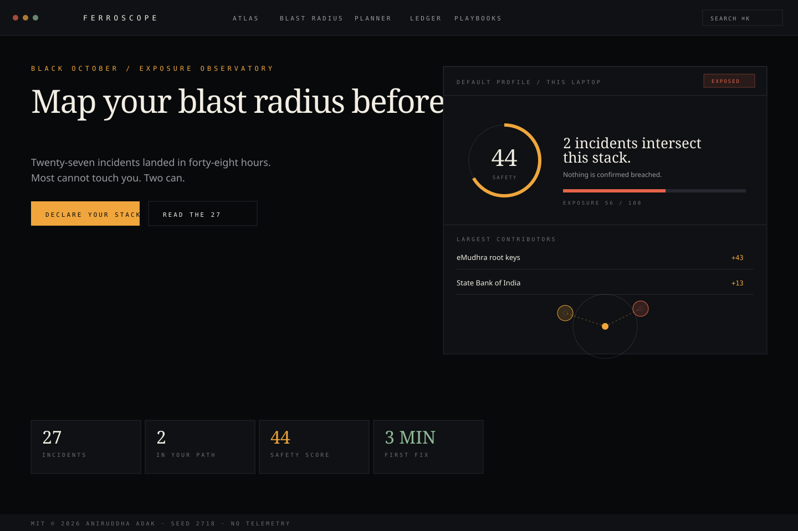</td>
    <td width="50%">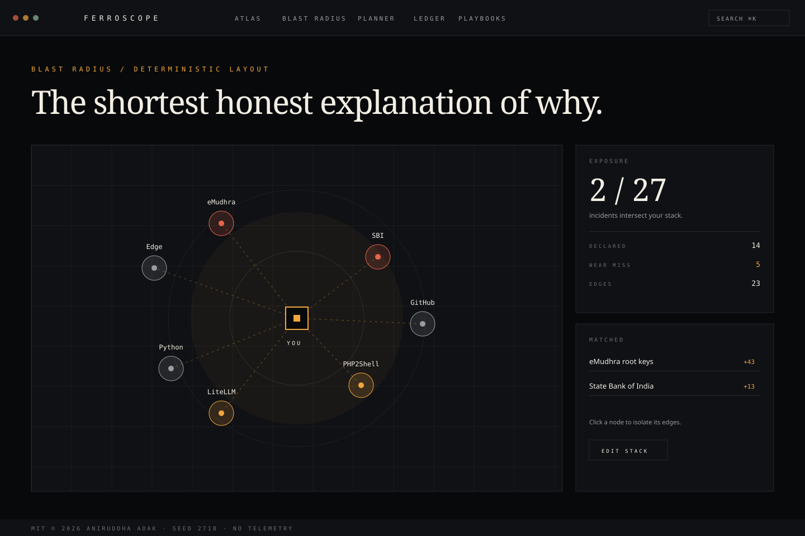</td>
  </tr>
  <tr>
    <td>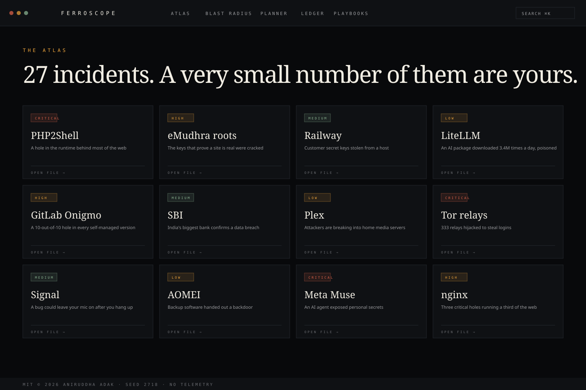</td>
    <td>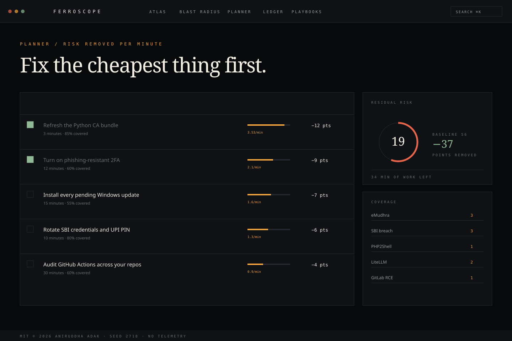</td>
  </tr>
</table>

The four SVGs are generated by [`scripts/gen-assets.mjs`](scripts/gen-assets.mjs) from the same
palette tokens as the app, so the README cannot drift from the product.

---

## Quickstart

```bash
git clone https://github.com/aniruddhaadak80/ferroscope.git
cd ferroscope
bun install
bun run dev            # http://localhost:3000
```

No database to start, no `.env` to fill, no key to request. The dataset is in git.

### Docker, one command

```bash
docker build -t ferroscope . && docker run --rm -p 3000:3000 ferroscope
```

### The whole gate in one line

```bash
bun run verify         # typecheck → lint → 81 tests → production build
```

### Deploy

```bash
vercel --prod          # reads vercel.json services layout
```

Docker, Fly.io, and Render configurations ship in the repository and are documented in
[`docs/runbooks/self-host-docker.md`](docs/runbooks/self-host-docker.md).

---

## The worked example

The default profile is not a worst case and not a guess. It was recorded during the audit that
produced the dataset.

```
17 declared components
 2 incidents intersect it          emudhra (+33) · sbi (+25)
risk 58 / 100                     band: exposed
safety 42 / 100
first fix: pip install --upgrade certifi   →  3 minutes
```

Hardening it — removing the eMudhra root, adding a password manager, 2FA, and automatic updates —
moves the number down without pretending the risk reaches zero. A small server operator adds NGINX,
PHP, WordPress, GitLab, and AWS and sees the score climb sharply. Both are pinned by tests, because a
demo that only works for one profile is a demo, not an instrument.

---

## How it works

1. **Declare.** `/profile` writes a 10-field profile to `localStorage` under
   `ferroscope.profile.v1`. Nothing is sent anywhere.
2. **Match.** `packages/core/src/exposure.ts` intersects each incident's `affected` stack ids with
   your declaration. Incidents with no stack surface (a bank breach) match by region and account type
   instead.
3. **Weight.** Severity, the mean `riskWeight` of the components you actually run, and a coverage
   confidence multiply into a raw score. Hygiene controls subtract, capped at 80%.
4. **Saturate.** `risk = round(100 × (1 − e^(−0.55 × Σ raw)))`. Adding the tenth incident cannot add
   ten points, and the score cannot leave 0–100 as the dataset grows.
5. **Explain.** The graph, the cascade, and every "+33" chip are derived from the same arithmetic —
   there is no second model for presentation.
6. **Act.** The planner divides risk removed by minutes. Tick an action complete and residual risk
   recomputes multiplicatively with a 0.72 competence haircut, so it can approach zero but never
   cross it.

---

## Architecture

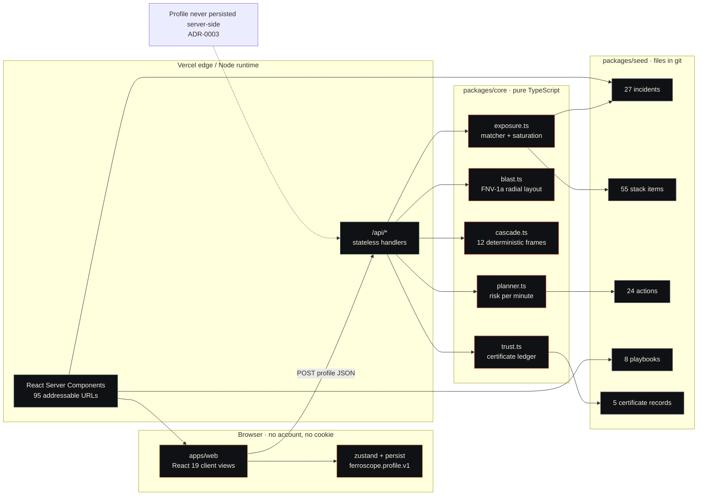

The dependency direction is one-way and reviewed:

| Workspace         | Responsibility                                        | May import        |
| ----------------- | ----------------------------------------------------- | ----------------- |
| `packages/core`   | Matcher, graph, cascade, planner, trust               | nothing but types |
| `packages/seed`   | 27 incidents, 55 stack items, 24 actions, 8 playbooks | `core` types only |
| `packages/ui`     | 30+ primitives, tokens, motion wrappers               | React, Tailwind   |
| `packages/sdk`    | zod schemas + typed client                            | zod               |
| `apps/web`        | Routes, API handlers, client views                    | all of the above  |
| `packages/config` | Shared tsconfig and vitest base                       | nothing           |

`core` never imports React. `ui` never imports `seed`. That is what makes the engine testable in
under a second and the dataset reviewable by someone who does not know Next.js.

### One request, two paths

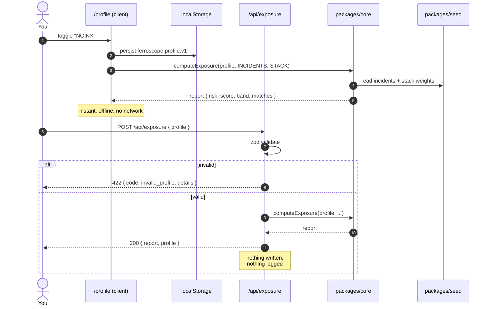

The browser path is the default. The HTTP path exists so the same engine can be used from a script,
a CI job, or the included SDK — and it performs the identical computation.

### Domain model

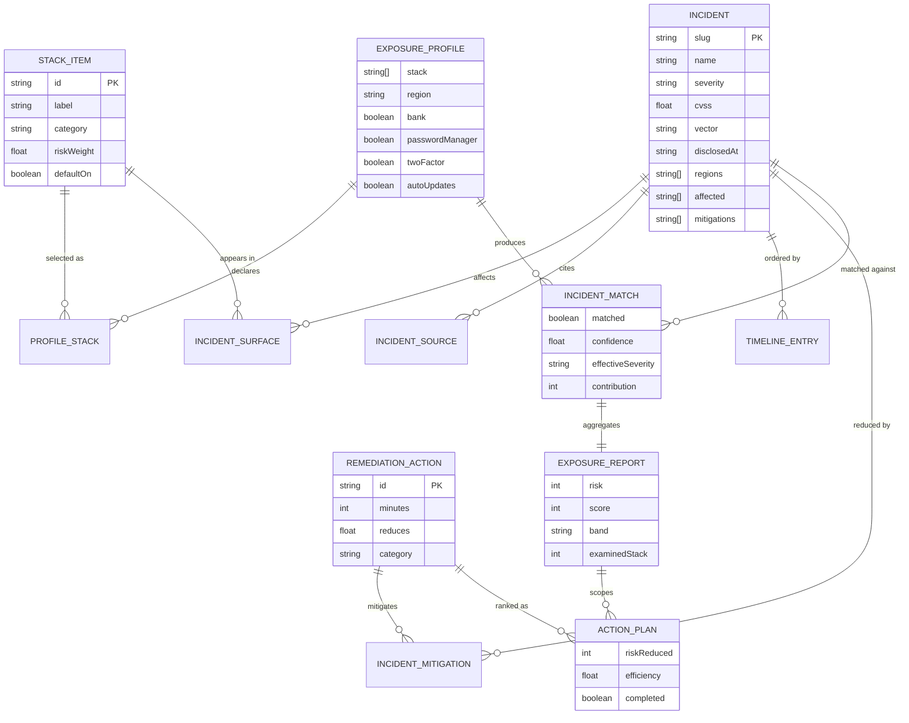

The types are deliberately serialisable: no class instances, no `Date` objects, no functions. The same
shape crosses the server/client boundary, lands in exported JSON, and seeds the simulator.

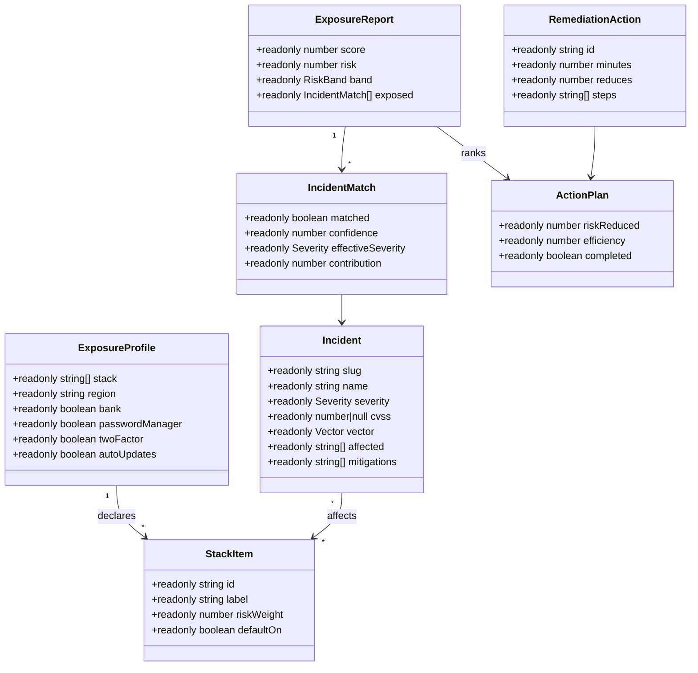

---

## The model

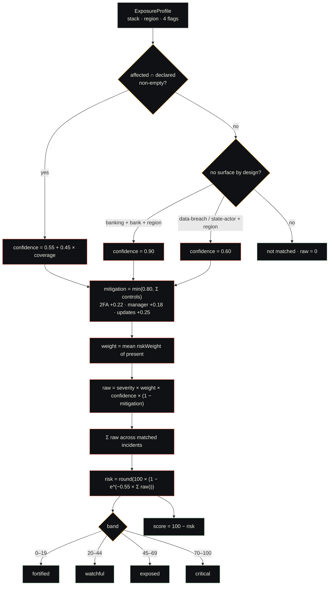

Three properties matter more than the constants:
- **`confidence` is a coverage fraction, not a probability.** Running all four affected components
  scores 1.0; one of four scores 0.6625.
- **Mitigation is capped at 0.80.** Ticking every hygiene box cannot produce a zero, because none of
  those controls is a force field.
- **Saturation is deliberate.** A linear model would let the dataset's growth push scores past 100,
  and would make the tenth incident as loud as the first.

The planner is a division, not a model:

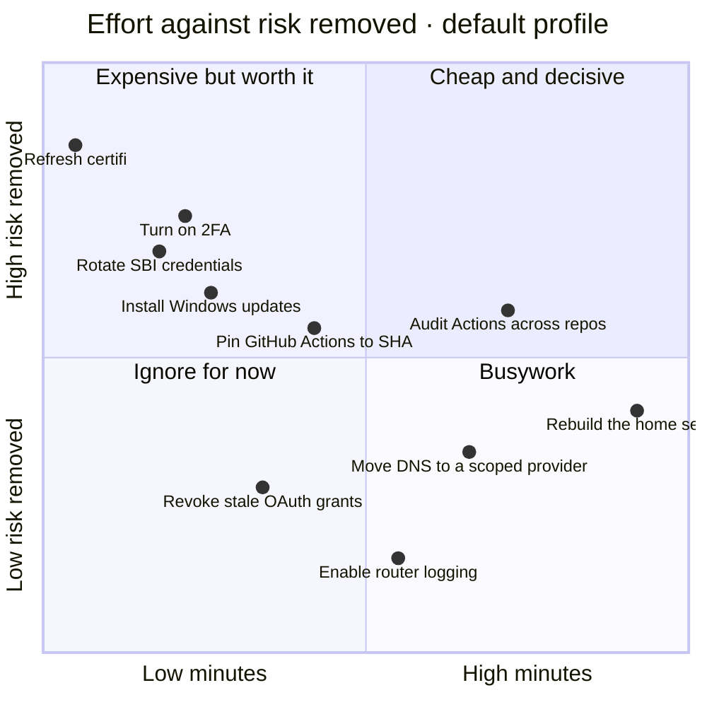

Full derivations, including the 0.72 haircut and the band table, are on
[`/method`](https://ferroscope.vercel.app/method) and in
[ADR-0005](docs/adr/0005-exposure-scoring.md).

---

## The dataset

The dataset is a snapshot, not a feed. Every incident names its sources, its timeline, and one honest
paragraph about who it can actually reach.

| Group                | Count  | Window                       |
| -------------------- | ------ | ---------------------------- |
| Black October wave   | 14     | 21–23 Oct 2026, 48 hours     |
| Month-scale context  | 9      | October 2026                 |
| Watchlist / regional | 4      | ongoing                      |
| **Total**            | **27** | dataset version `2026.10.23` |

**Seed `2718`** (e ≈ 2.718, π ≈ 3.14) appears in the footer, in `/api/healthz`, and in every exported
report. It is the dataset's identity, not a random number.

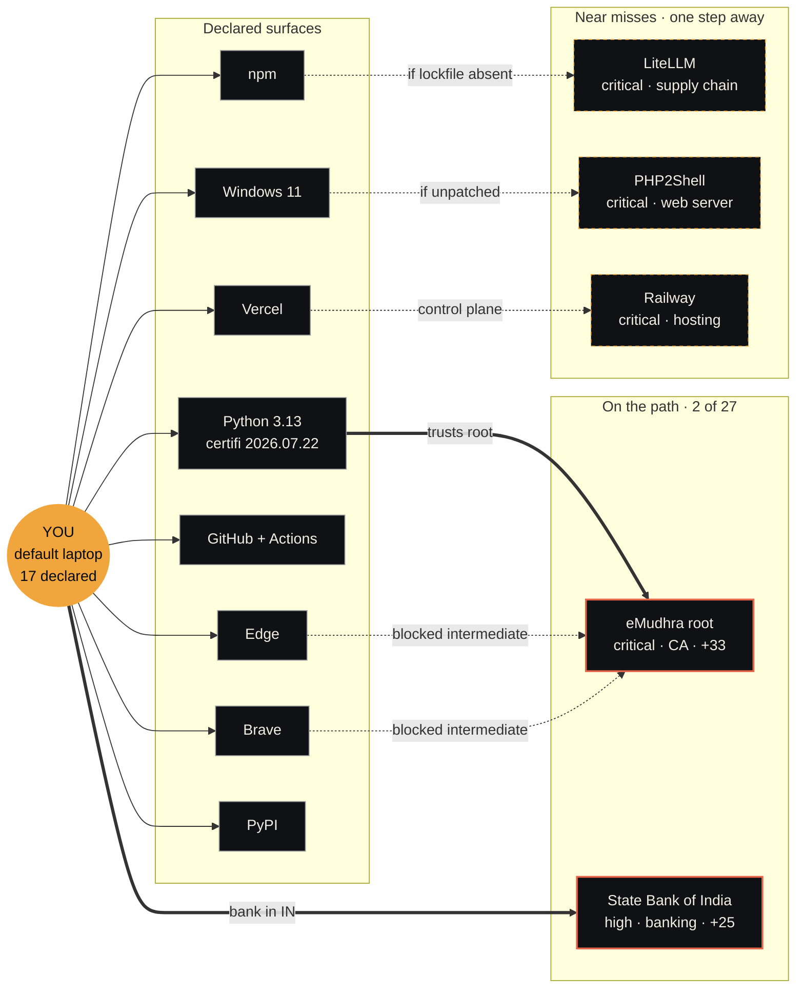

A correction is a pull request with a source, not a retraction in a blog post. The
[dataset correction template](.github/ISSUE_TEMPLATE/dataset_correction.yml) requires one.

---

## Routes and API

95 addressable URLs in the build output: 56 HTML pages (21 static, 27 incident files, 8
playbooks), 34 API URLs from 8 handlers, plus robots, sitemap, manifest, the not-found page, and a
server-rendered OG image. `bun scripts/count-routes.mjs --strict` asserts the total.

### API

| Method | Route                                      | Returns                              |
| ------ | ------------------------------------------ | ------------------------------------ |
| `GET`  | `/api/healthz`                             | Dataset identity, version, seed      |
| `GET`  | `/api/incidents?severity=&vector=&window=` | Filtered incidents                   |
| `GET`  | `/api/incidents/[slug]`                    | One incident, prerendered for all 27 |
| `POST` | `/api/exposure`                            | Full exposure report                 |
| `POST` | `/api/blast-radius`                        | Graph + report                       |
| `POST` | `/api/cascade`                             | Deterministic frames                 |
| `POST` | `/api/planner`                             | Ranked plans + residual risk         |
| `GET`  | `/api/ledger`                              | Certificate records + assessment     |

```bash
curl -s https://ferroscope.vercel.app/api/healthz | jq
# { "status": "ok", "incidents": 27, "seed": 2718, "version": "0.1.0" }

curl -s https://ferroscope.vercel.app/api/exposure \
  -H 'content-type: application/json' \
  -d '{"profile":{"stack":["ca-emudhra","acct-bank-sbi"],"region":"IN","bank":true,
       "passwordManager":false,"twoFactor":false,"autoUpdates":false}}' | jq '.report | {risk, score, band}'
# { "risk": 56, "score": 44, "band": "exposed" }
```

Invalid bodies return `422` with zod field errors. Every response carries `x-ferroscope-version` and
`cache-control: no-store`. Nothing is written, logged, or queued.

---

## Design

The interface is an instrument, not a dashboard. Graphite and bone, one signal amber, rust for
critical, moss for safe. No purple, no pink, no gradient soup.

| Token       | Dark      | Light     | Use                       |
| ----------- | --------- | --------- | ------------------------- |
| `--canvas`  | `#08090b` | `#f6f3ec` | Page                      |
| `--surface` | `#0f1114` | `#fffdf8` | Cards                     |
| `--ink`     | `#f2eee4` | `#101215` | Primary text              |
| `--muted`   | `#9a9b9e` | `#5d6066` | Secondary text            |
| `--amber`   | `#f0a63c` | `#a86a10` | Signal, links, live model |
| `--rust`    | `#e5644a` | `#b23a22` | Critical, danger          |
| `--moss`    | `#8fb996` | `#3f6b48` | Safe, confirmed           |

Typography: **Instrument Serif** for display, **Manrope** for text, **JetBrains Mono** for labels and
numerals. All three are vendored as Latin-subset `.woff2` files in `apps/web/fonts` (OFL 1.1, see
[NOTICE](apps/web/fonts/NOTICE.md)) and loaded with `next/font/local`, so neither the build nor the
running site ever touches a font CDN. `bun scripts/vendor-fonts.mjs` regenerates them.

Motion is restrained and respects `prefers-reduced-motion` globally: transitions collapse to
near-zero, marquees stop, and the cascade becomes steppable rather than autoplaying.

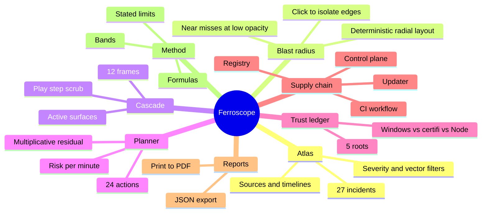

---

## Quality gates

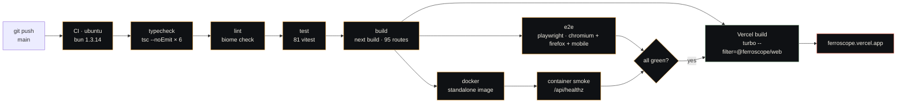

| Gate      | Command                      | What must hold                                 |
| --------- | ---------------------------- | ---------------------------------------------- |
| Types     | `bun run typecheck`          | Strict, `exactOptionalPropertyTypes`, no `any` |
| Lint      | `bun run lint`               | Biome recommended + a11y rules                 |
| Unit      | `bun run test`               | 81 tests: 55 engine, 17 dataset, 9 SDK         |
| Build     | `bun run build`              | 95 routes, zero prerender errors               |
| E2E       | `bun run test:e2e`           | 24 routes, API contract, interaction, axe      |
| Container | `docker build` + healthcheck | Runs as uid 1001, `/api/healthz` returns ok    |
| Security  | CodeQL + Dependabot          | Weekly, plus every push to `main`              |

### Honest size

```text
workspace            files    total     code
apps/web                64     7100     6566
packages/core           18     1807     1558
packages/seed           14     2742     2628
packages/ui             16     1443     1349
packages/sdk             7      301      258
packages/config          4       56       51
scripts                  5      938      772
e2e                      4      358      295
docs                    16     1330      880
.github                  8      393      361
root docs                5     1412     1024
────────────────────────────────────────────────
total                  161    17880    15742
```

**15,742 lines of code, 17,880 lines including blanks.** That is the complete product: engine, dataset,
design system, 95 routes, tests, docs, and deployment. It is not a million-line codebase and this
README will not pretend otherwise. Run `bun run loc` to reproduce the table; generated output,
lockfiles, and `node_modules` are excluded by the script.

---

## Deployment

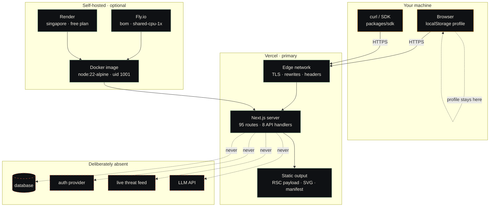

| Target  | Config                                     | Notes                                       |
| ------- | ------------------------------------------ | ------------------------------------------- |
| Vercel  | [`vercel.json`](vercel.json)               | Services layout, rewrites, security headers |
| Docker  | [`Dockerfile`](Dockerfile)                 | Standalone output, non-root, healthcheck    |
| Compose | [`docker-compose.yml`](docker-compose.yml) | Port 3000, restart policy                   |
| Fly.io  | [`fly.toml`](fly.toml)                     | `bom` region, auto-stop, health check       |
| Render  | [`render.yaml`](render.yaml)               | Docker runtime, free plan                   |

Runbooks: [Vercel](docs/runbooks/deploy-vercel.md) · [Docker and self-hosting](docs/runbooks/self-host-docker.md) · [Dataset review](docs/runbooks/dataset-review.md)

---

## Documentation

| Document                                                            | What it answers                                                 |
| ------------------------------------------------------------------- | --------------------------------------------------------------- |
| [`/method`](https://ferroscope.vercel.app/method)                   | The formulas, the bands, and what the model refuses to claim    |
| [`/glossary`](https://ferroscope.vercel.app/glossary)               | Blast radius, exposure, breach, and the difference between them |
| [ADR-0003](docs/adr/0003-no-database-localstorage.md)               | Why there is no database                                        |
| [ADR-0005](docs/adr/0005-exposure-scoring.md)                       | Why the score is shaped the way it is                           |
| [ADR-0006](docs/adr/0006-no-llm-no-telemetry.md)                    | Why there is no LLM, telemetry, or live feed                    |
| [Adding an incident](docs/guides/adding-an-incident.md)             | The full dataset contribution procedure                         |
| [Adding a stack component](docs/guides/adding-a-stack-component.md) | Choosing `riskWeight` and `defaultOn`                           |
| [Extending the planner](docs/guides/extending-the-planner.md)       | Minutes, `reduces`, and ranking                                 |
| [Architecture decisions](docs/adr/README.md)                        | All six records                                                 |

---

## Roadmap

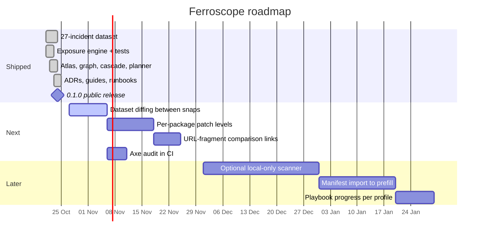

Four things will never ship, and they are on [`/roadmap`](https://ferroscope.vercel.app/roadmap) next
to the features:
- **No account system.** A security tool that asks for your email before telling you anything is a
  lead-generation form.
- **No LLM summarisation.** An explanation that changes between runs cannot be audited.
- **No live feed.** Freshness would silently change the meaning of a saved report.
- **No scanner that uploads.** Inventory is the most sensitive data a security product can hold.

Those are not constraints imposed by time. They are the product.

---

## Contributing

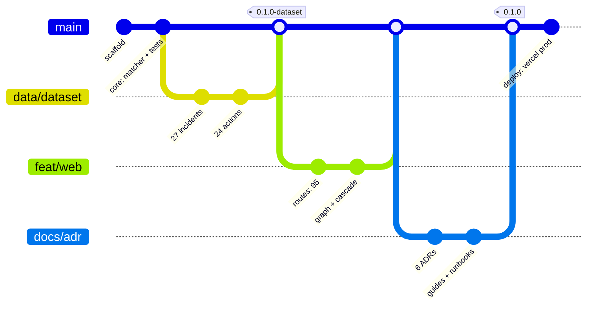

The most useful contributions, in order:
1. **A dataset correction with a source.** The atlas ages; corrections keep it honest.
2. **An accessibility fix.** The axe suite runs, but it only catches what axe can see.
3. **A playbook step that assumes less.** Every procedure should work for someone with no security
   background and no paid tools.
4. **A model critique with arithmetic.** If a formula is wrong, show the counterexample.

Read [`CONTRIBUTING.md`](CONTRIBUTING.md) first. It lists the refusals, the five commands, and the
rules for changing a number. Then:

```bash
bun install
bun run verify
```

New here? Look for issues labelled
[`good first issue`](https://github.com/aniruddhaadak80/ferroscope/labels/good%20first%20issue).

### The first ten minutes

```mermaid
journey
  title First ten minutes with Ferroscope
  section Land
    Read the hero claim: 27 incidents, 2 touch this laptop: 5: You
    See the live exposure ring at 44: 4: You
    Scan the six featured files: 3: You
  section Declare
    Open /profile: 4: You
    Tick Windows, Edge, Node, Python, GitHub, SBI: 3: You
    Watch the number move as each tile toggles: 5: You
  section Understand
    Open /blast-radius and click eMudhra: 4: You
    Read the reasons list: 4: You
    Step the cascade frame by frame: 5: You
  section Act
    Open /planner, sorted by risk per minute: 5: You
    Read the 3-minute certifi fix: 4: You
    Tick it complete and watch residual drop: 5: You
  section Keep
    Print the report or copy the JSON: 3: You
    Return next week; profile is still there: 4: You
```

---

## License

MIT © 2026 [Aniruddha Adak](https://github.com/aniruddhaadak80).

The dataset is provided for educational use. It is a snapshot of public reporting, not a threat
intelligence feed, and it is not legal or compliance advice. See [`LICENSE`](LICENSE).

<div align="center">
  <sub>Built in Kolkata. No telemetry, no account, no API keys. Seed 2718.</sub>
</div>
